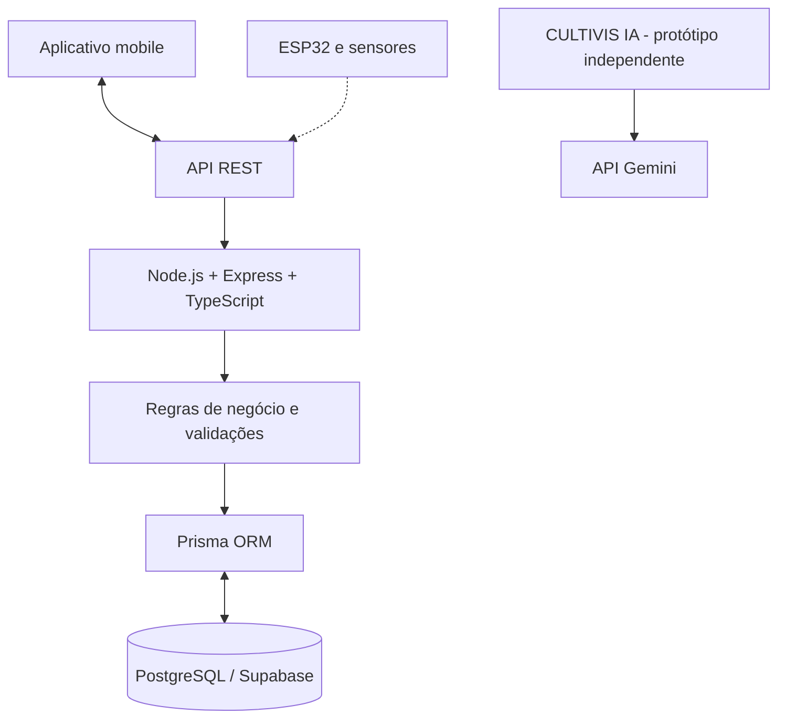

# Arquitetura do CULTIVIS

## Visão geral

O CULTIVIS é um sistema de gerenciamento e monitoramento agrícola que reúne uma aplicação mobile, um back-end, persistência de dados e componentes de Internet das Coisas (IoT). O projeto também conta com um protótipo independente de inteligência artificial.

## Componentes da solução

- **Aplicativo mobile:** interface para interação com as funcionalidades do sistema. O estado atual de implementação será atualizado após confirmação da equipe.
- **Back-end:** desenvolvido com Node.js, Express e TypeScript, responsável pelas rotas da API, regras de negócio, validações e processamento de dados.
- **Banco de dados:** PostgreSQL, com Prisma ORM e Supabase.
- **Autenticação e validação:** Supabase Auth e Zod, além de mecanismos de proteção de informações sensíveis.
- **IoT:** ESP32 DevKit V1, sensor DHT11 para temperatura e umidade e sensor de pH 4502C.
- **CULTIVIS IA:** protótipo independente que utiliza a API do Gemini para auxiliar na consulta de informações e na elaboração de configurações sugeridas.

## Diagrama conceitual

O diagrama abaixo representa os principais componentes planejados e desenvolvidos no projeto. As conexões específicas entre os módulos devem ser confirmadas conforme a implementação atual.

> **Observação:** o diagrama é uma visão conceitual. As conexões pontilhadas e os fluxos entre componentes deverão ser ajustados após a confirmação da integração efetivamente implementada.

## Evolução da arquitetura

A documentação será atualizada conforme a equipe confirmar o estado do aplicativo mobile, as integrações de hardware e a evolução do protótipo de inteligência artificial.
